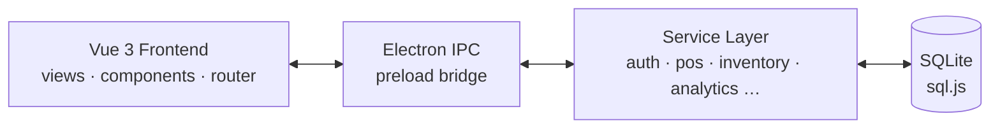

<div align="center">

# Food Business Manager

**An all-in-one desktop app for cafes, food trucks, and small restaurants.**

Run your POS, staff, inventory, and finances from one place, with role-based access and live analytics.

[](https://www.electronjs.org/)
[](https://vuejs.org/)
[](https://tailwindcss.com/)
[](https://sql.js.org/)
[](https://vitejs.dev/)

[](LICENSE)


[Features](#features) •
[Quick Start](#quick-start) •
[Tech Stack](#tech-stack) •
[Roles](#roles--permissions) •
[Project Structure](#project-structure) •
[Team](#team)

</div>

---

## Overview

Food Business Manager is a cross-platform **Electron + Vue 3** desktop application built as a class project for **COP 4331: Software Engineering**. It gives small food-service operators the tools a larger restaurant would have, without the enterprise price tag or complexity.

> [!NOTE]
> Owners and managers get a full analytics dashboard. Operational staff (chefs, servers, cashiers, drivers) are routed to a focused **Employee Portal** with only the tools they need.

---

## Features

<table>
<tr>
<td width="50%" valign="top">

### Point of Sale
- Fast checkout with keyboard shortcuts
- Cash, card, and digital payments, with split bills and discounts
- **Modifier groups** per item (e.g. Size: pick 1, Toppings: up to 3)
- Dine in, takeout, or delivery, with table numbers
- **Open tabs**: hold an order, send it to the kitchen, pay later
- Partial refunds by item or amount, and receipt reprints

</td>
<td width="50%" valign="top">

### Dashboard & Analytics
- Live KPIs, sales trends (week / month / year)
- **Profit Pulse** business-health indicator
- Live order feed and top performers
- Goal tracking, alerts, and activity feed

</td>
</tr>
<tr>
<td valign="top">

### Employee Management
- Profiles, accounts, and granular permissions
- Time clock with regular and overtime hours
- Payroll and weekly schedule calendar
- Shift swaps, time-off requests, and tasks

</td>
<td valign="top">

### Employee Portal
- Clock in/out with elapsed-time tracking
- Personal daily and weekly schedule
- Task checklist and announcements
- Time history and hours summary

</td>
</tr>
<tr>
<td valign="top">

### Inventory Control
- Stock levels with minimum thresholds
- **Recipes**: selling an item takes its ingredients out of stock (voids put them back)
- Low-stock and reorder alerts
- Quick adjustments, out-of-stock marking, and suppliers

</td>
<td valign="top">

### Menu Management
- Items, categories, and descriptions
- Pricing and availability controls
- One-click out-of-stock toggles
- Reusable **modifier groups** with min/max choices and per-option prices
- Per-item **recipes** linking menu items to inventory ingredients

</td>
</tr>
<tr>
<td valign="top">

### Customers & Loyalty
- Customer profiles and purchase history
- Loyalty points, rewards, and promotions
- Reservations

</td>
<td valign="top">

### Reports & Cash
- Sales, expenses, and profit and loss
- **Cash drawer**: opening float, pay-ins/outs, count and over/short at close
- **End-of-day report** by payment method, order type, voids, and refunds
- Export to **PDF** and **Excel**

</td>
</tr>
</table>

### Security & Data Safety
- bcrypt password hashing and signed session tokens (JWT), with a random signing secret generated per installation
- **Permissions enforced in the backend**: every request needs a signed-in user; voids, refunds, and menu changes need a manager or a fresh owner-code approval; backups, settings, and staff management are manager-only
- **Audit log** of sign-ins, voids, refunds, discounts, price changes, drawer activity, and settings
- All database queries use bound parameters, never string-built SQL
- The UI runs with Node.js disabled and context isolation on, behind a minimal preload bridge
- **Backups**: automatic daily backups, export to any drive, and safe restore (a copy of the current data is kept first)

---

## Quick Start

> [!IMPORTANT]
> Requires **Node.js 20.19+** (needed by Vite 7) and **npm**.

```bash
# 1. Clone
git clone https://github.com/AndrewPuig77/Small-Food-Business-Management-System.git
cd Small-Food-Business-Management-System

# 2. Install
npm install

# 3. Run
npm run dev
```

For detailed setup and troubleshooting, see **[INSTALLATION.md](INSTALLATION.md)**.

### Scripts

| Command | Description |
| --- | --- |
| `npm run dev` | Start the app in development mode |
| `npm run build` | Build for production |
| `npm run preview` | Preview the production build |
| `npm run lint` | Lint the codebase |
| `npm test` | Run the automated tests (Jest, see [Testing](#testing)) |
| `npm run dist` | Build and package installers for the current OS |
| `npm run dist:win` / `dist:mac` / `dist:linux` | Package for a specific platform |

---

## Testing

`npm test` runs the integration tests in `tests/integration` against a real (temporary) SQLite database. Each test file gets its own database.

| Suite | Covers |
| --- | --- |
| `existing-services` | Auth, menu, inventory, employees, POS, and other core services |
| `modifiers` | Modifier groups, selection rules, and checkout validation |
| `order-type` | Dine in / takeout / delivery, tables, and the stored tax rate |
| `cash-drawer` | Drawer sessions, pay-ins/outs, variance, and end-of-day reports |
| `refunds` | Partial refunds, limits, and their effect on the drawer and reports |
| `tabs` | Holding, updating, paying, and cancelling open tabs |
| `backups` | Automatic, manual, export, and restore, including bad files |
| `access-control` | Backend permissions, owner-code approvals, password resets, audit log |
| `recipes` | Ingredient deduction on sale, voids, tabs, and cleanup |

---

## Tech Stack

| Layer | Technology |
| --- | --- |
| **Desktop shell** | Electron (context-isolated renderer + preload bridge) |
| **UI** | Vue 3 (Composition API), Vue Router, Vuex |
| **Styling** | Tailwind CSS |
| **Build** | Vite + `vite-plugin-electron` |
| **Database** | SQLite via sql.js |
| **Charts** | Chart.js |
| **Auth** | bcryptjs, JSON Web Tokens |
| **Exports** | jsPDF, SheetJS (xlsx) |
| **Packaging** | electron-builder (NSIS, portable, DMG, AppImage, deb) |

### Architecture



---

## Roles & Permissions

| Role | Lands on | Access |
| --- | --- | --- |
| **Owner / Manager** | Main dashboard | Full system access, employee and account management, financials, configuration, bypasses owner-code checks |
| **Chef** | Employee portal | Menu management, kitchen view, order tracking, inventory viewing |
| **Server / Cashier** | Employee portal | POS, order management, customer interaction, limited inventory view |
| **Driver** | Employee portal | Order tracking, delivery management, customer info |
| **Staff** | Employee portal | Time tracking, tasks, announcements, plus any assigned permissions |

<details>
<summary><b>How it works under the hood</b></summary>

<br/>

- **Role-based routing:** admins go to the analytics dashboard, operational staff go to the Employee Portal.
- **Granular permissions:** stored per employee as JSON, so access can be customized beyond the default role.
- **Owner code:** sensitive operations require owner verification.
- **Linked accounts:** user logins are tied to employee records, with active/inactive status and password resets that never reveal the current password.
- **Real-time sync:** dashboard widgets, clock status, schedules, and tasks auto-refresh every 5–30 seconds.

</details>

---

## Project Structure

<details>
<summary><b>Click to expand</b></summary>

```
src/
├── backend/
│   ├── database/
│   │   ├── database.js            # SQLite init, migrations, batched saves
│   │   └── sql.js                 # sql`` tag for parameterized queries
│   ├── security/
│   │   ├── accessControl.js       # Per-handler permission rules
│   │   └── auditHooks.js          # Records sensitive actions to the audit log
│   ├── services/                  # Business logic layer
│   │   ├── analyticsService.js
│   │   ├── announcementService.js
│   │   ├── auditService.js        # Audit log reads and writes
│   │   ├── authService.js
│   │   ├── backupService.js       # Automatic/manual backups, export, restore
│   │   ├── cashDrawerService.js   # Drawer sessions, pay-ins/outs, end-of-day
│   │   ├── dashboardService.js
│   │   ├── employeeService.js
│   │   ├── expenseService.js
│   │   ├── inventoryService.js
│   │   ├── menuService.js
│   │   ├── modifierService.js     # Modifier groups and options
│   │   ├── posService.js          # Checkout, order types, open tabs
│   │   ├── recipeService.js       # Ingredient deduction from stock
│   │   ├── refundService.js       # Partial and full refunds
│   │   ├── reservationService.js
│   │   ├── scheduleService.js
│   │   ├── shiftSwapService.js
│   │   ├── taskService.js
│   │   ├── timeLogService.js
│   │   └── timeOffService.js
│   └── ipc.js                     # IPC handlers
├── frontend/
│   ├── components/
│   │   ├── dashboard/             # Dashboard widgets (SalesChart, ProfitPulse, LiveOrderFeed, …)
│   │   ├── AlertModal.vue
│   │   ├── BackupsPanel.vue       # Backup and restore controls (Profile)
│   │   ├── ConfirmModal.vue
│   │   ├── DrawerReport.vue       # End-of-day drawer report
│   │   ├── LoadingSpinner.vue
│   │   ├── OwnerCodeModal.vue
│   │   ├── Sidebar.vue
│   │   └── Toast.vue
│   ├── composables/               # useModals, useOwnerVerification, useAutoRefresh, useToast, …
│   ├── router/
│   ├── views/                     # Dashboard, POS, Menu, Inventory, Cash Drawer, Audit Log, Reports, …
│   └── App.vue
└── main/
    ├── main.js                    # Electron main process
    └── preload.js                 # Exposes the IPC bridge to the UI

config/                            # Vite and build config
docs/                              # Requirements, design, and specifications
tests/
├── integration/                   # Jest integration tests, one file per feature
├── helpers/                       # Temporary test database setup
└── mocks/                         # Electron stub for running outside the app
database/                          # Local SQLite files (gitignored)
```

</details>

<details>
<summary><b>Database tables</b></summary>

<br/>

| Table | Purpose |
| --- | --- |
| `businesses` | Business information |
| `users`, `sessions` | Authentication |
| `employees`, `employee_notes`, `employee_documents`, `emergency_contacts` | Employee profiles |
| `employee_schedules`, `shifts`, `employee_availability` | Work schedules |
| `time_logs` | Clock in/out records |
| `employee_tasks` | Task assignments |
| `announcements` | Staff communications |
| `time_off_requests` | Leave requests |
| `shift_swap_requests` | Schedule exchanges |
| `menu_categories`, `menu_items` | Menu catalog |
| `modifier_groups`, `modifier_options`, `menu_item_modifier_groups` | Item modifiers |
| `menu_item_recipes` | Ingredients used per menu item |
| `inventory_categories`, `inventory_items`, `inventory_transactions`, `inventory_waste`, `suppliers` | Stock tracking |
| `transactions`, `transaction_items`, `payment_methods` | Sales records, including open tabs |
| `refunds` | Refunds against completed sales |
| `cash_drawer_sessions`, `cash_drawer_movements` | Cash drawer shifts and pay-ins/outs |
| `customers` | Customer database |
| `reservations` | Table reservations |
| `expenses`, `recurring_expenses` | Expense tracking |
| `audit_log` | Record of sensitive actions |

Full schema: [docs/design/database-schema.md](docs/design/database-schema.md)

</details>

---

## Recent Updates

- [x] Employee portal with clock in/out, schedule, tasks, and announcements
- [x] Modern dashboard with analytics widgets
- [x] Role-based routing and permissions
- [x] Owner verification system
- [x] Account management in the employee edit form
- [x] Database migrations for schema updates
- [x] Real-time data synchronization
- [x] POS keyboard shortcuts
- [x] Modifier groups per menu item
- [x] Order type and table number at the POS
- [x] Cash drawer sessions and end-of-day reports
- [x] Partial refunds and receipt reprints
- [x] Open tabs and held orders
- [x] Automatic backups, export, and restore
- [x] Audit log and permission checks in the backend
- [x] Recipe-based stock deduction
- [x] Automated test suite (`npm test`)

---

## Team

<table>
<tr>
<td align="center"><b>Andrew Puig</b></td>
<td align="center"><b>Treasure Brown</b></td>
<td align="center"><b>Jorge Carmenate</b></td>
</tr>
<tr>
<td align="center"><b>Joseph Contreras</b></td>
<td align="center"><b>Steven Palacios</b></td>
<td align="center"><b>Andreani Pineda</b></td>
</tr>
</table>

---

## License

Released under the [MIT License](LICENSE). Built for educational purposes as part of **COP 4331 Software Engineering** (Fall 2025).

<div align="center">

**Questions or found a bug?** [Open an issue](https://github.com/AndrewPuig77/Small-Food-Business-Management-System/issues)


</div>
